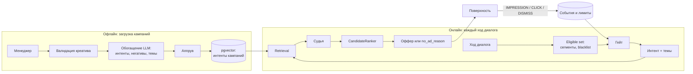
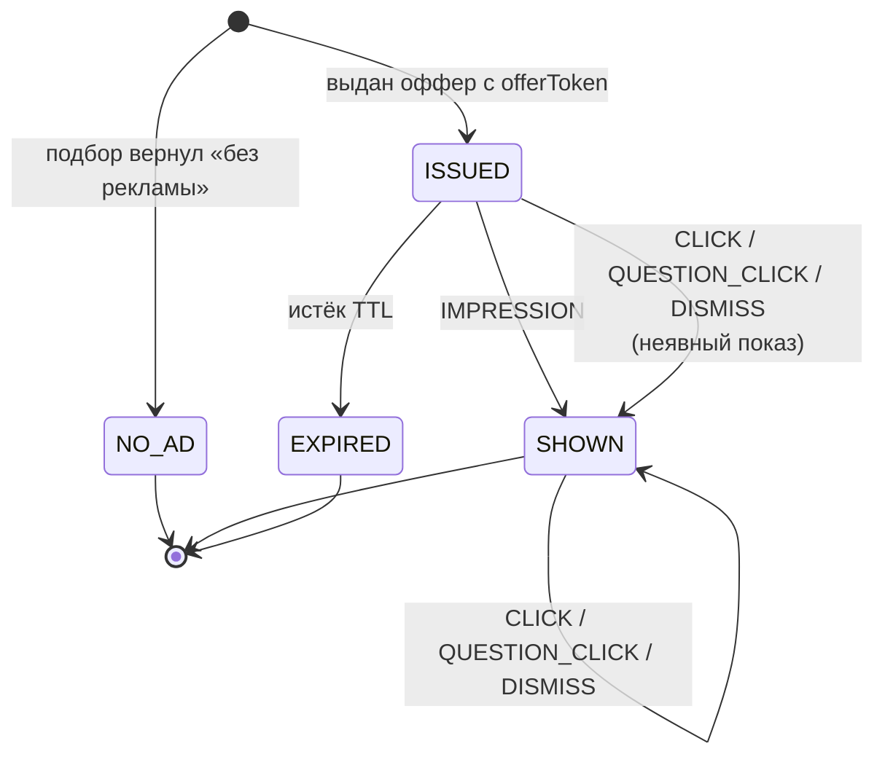
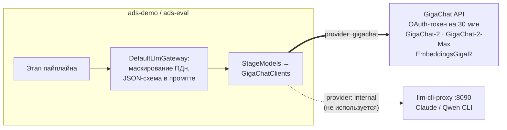

# Подбор рекламы в диалоге с агентом — дизайн прототипа

Nov 9, 2026 · @Vasily

> Копия документа из [Claude Docs](https://claude.ai/artifact/WSUbZHkFXCJFzMBmQ3LZBW); диаграммы переведены в Mermaid.

## Контекст и цели

Прототип должен на каждом ходе диалога клиента с агентом банка выбирать одну релевантную кампанию собственного продукта или осознанно не показывать ничего. Кампании загружают менеджеры: бизнес-описание, креатив и сегменты.

Прототип считаем успешным, если:

- на golden set из 100–200 размеченных диалогов правильная кампания на первом месте (precision@1) не ниже целевого порога, который фиксируем после первого прогона;
- в диалогах со стоп-темами реклама не показывается ни разу;
- подбор укладывается в бюджет задержки и не замедляет ответ агента;
- одну и ту же логику можно запустить на любой модели: продовой через API, Claude CLI в тестах, Qwen CLI локально.

Вне рамок прототипа: обученная модель pCTR, интеграция с боевым ранжировщиком, маркировка в ОРД, нагрузочное тестирование, продовый UI, приём конверсий из фоновых потоков.

## Как это делают другие

У всех, кто внедрил рекламу в ИИ-чат, её подбирает отдельная система, а показывается она размеченным блоком рядом с ответом, а не внутри него.

| Игрок | Как подбирается | Формат |
| --- | --- | --- |
| [OpenAI, ChatGPT](https://openai.com/index/building-chatgpt-ad-stack/) | Отдельная LLM (orchestrator) переписывает диалог в запросы, поиск по эмбеддингам, LLM номинирует кандидатов, цену и победителя ставит аукцион. После аукциона может снять неуместное объявление. Не успела к ответу — выбрасывается. | Блок Sponsored под ответом. Рекламодатель описывает ситуации текстом (context hints) |
| [Microsoft Copilot](https://searchengineland.com/microsoft-copilot-showroom-ads-dynamic-filters-453019) | По смыслу разговора, креативы из поисковых кампаний | Под ответом с фразой «почему это уместно», интерактивные Showroom ads |
| [Google AI Mode](https://www.techbrew.com/stories/2026/01/14/google-search-ai-mode-ads) | Поисковая реклама в ИИ-выдаче | Товарные блоки и персональные офферы |
| [Amazon Rufus](https://www.intentwise.com/blog/explained-sponsored-prompts-ads-on-amazon) | Amazon сам генерирует вопросы по данным карточки товара, CPC | Sponsored Prompts посреди диалога |
| [Perplexity](https://searchengineland.com/perplexity-begins-testing-ads-448277) | Спонсорские следующие вопросы с 2024 года. По [неподтверждённым данным](https://digitalapplied.com/blog/perplexity-abandons-advertising-ai-search-monetization), свернуты в феврале 2026 | Sponsored follow-up |
| [Anthropic, Claude](https://www.theregister.com/2026/02/04/anthropic_no_advertising_in_claude/) | Публично отказались от рекламы в феврале 2026 | — |

Что берём себе:

1. Ответ и реклама считаются раздельно. Модель агента не знает о кампаниях.
2. Кампанию описывают ситуациями клиента, а не ключевыми словами.
3. Воронка от дешёвого к дорогому: гейт → интент → retrieval → LLM-судья → ранжирование.
4. «Без рекламы» — нормальный результат со своей причиной в логе.
5. Жёсткий дедлайн: опоздавшая реклама не показывается.
6. Прозрачность: метка «Реклама», «почему я это вижу», «скрыть».

Детали архитектуры OpenAI взяты из пересказов их поста от 21.10.2026 ([Forbes](https://www.forbes.com/sites/gabrielalinzainescu/2026/10/23/chatgpt-ads-run-on-an-ai-that-understands-intent-and-keeps-answers-independent/), [SEJ](https://www.searchenginejournal.com/openai-details-chatgpt-llm-ad-stack/593857/)), а не из самого поста.

## Требования и ограничения

Каждое требование ниже напрямую определяет одно решение в архитектуре.

| Требование | Решение |
| --- | --- |
| Кампании — собственные продукты банка, сейчас ранжируются по доходности, CTR и CR | Аукциона нет. Ранжирование спрятано за интерфейсом, потом подключим текущий ранжировщик |
| Формат — карточка или вопрос | Два типа креатива, оба из одобренного набора. Формат выбирает LLM-судья под контекст |
| Сегменты — бинарные, известны не из диалога | В прототипе чёрный список сегментов в начале сессии. Сегменты не передаются в LLM |
| Подбор на каждом ходе | Дешёвый гейт, кэш по темам и интенту, правила частоты, запуск параллельно с ответом |
| Тысячи кампаний | Retrieval через pgvector с фильтром по допущенным кампаниям |
| Событие показа приходит явно от поверхности | Решение (AdOffer) и показ (IMPRESSION) разделены, считаем только показы |
| Банковский домен | Стоп-темы, одобренные тексты, grounding после клика, маскирование персональных данных |
| Стек: Java 17–21, Spring Boot | Java 21 (виртуальные потоки), Spring Boot, Spring AI, Gradle |
| Любые модели | Модель назначается каждому этапу в конфиге |
| Локальная отладка и тесты | Локальный OpenAI-совместимый прокси llm-cli-proxy поверх Qwen CLI и Claude CLI; приложение о CLI не знает. Сейчас не используется: отладка идёт на публичном GigaChat API |

## Архитектура

Система делится на две части. Офлайн кампании готовятся к поиску. Онлайн на каждом ходе выбирается одна кампания или ничего.



Оркестратор агента запускает подбор параллельно с генерацией ответа и ждёт его не дольше `deadlineMs`. Подбор видит только текст диалога и допущенные кампании, сегменты клиента остаются в фильтре eligible set.

**Бюджет задержки.** Подбор не должен задерживать ответ, поэтому дедлайн равен ожидаемому времени генерации ответа и передаётся в запросе. Дешёвые этапы (гейт и интент) идут первыми и отсекают большинство ходов ещё до вызова сильной модели. Параллельность — виртуальные потоки Java 21 и `CompletableFuture.orTimeout`.

## Загрузка кампаний

В бой попадает только то, что одобрил менеджер. LLM лишь предлагает черновики интентов и вопросов.

1. Менеджер заводит кампанию: бизнес-описание, карточка (заголовок, текст, картинка, CTA, ссылка, ERID), чёрный список сегментов, сроки, исключённые темы.
2. LLM по описанию генерирует:
   - 10–30 позитивных интентов — ситуаций, в которых продукт уместен («клиент планирует ремонт и считает бюджет»);
   - 5–10 негативных интентов — близких по смыслу, но неуместных («клиент жалуется на списание по кредиту»);
   - 5–15 вариантов вопроса от лица клиента («Сколько я сэкономлю на рефинансировании?»);
   - 1–3 темы из той же таксономии, что и для диалогов.
3. Менеджер правит и одобряет интенты и вопросы.
4. Валидация креатива: если в тексте есть ставка или сумма, должен быть заполнен дисклеймер с условиями. Проверяем правилом, а LLM только подсвечивает сомнительное.
5. Одобренные интенты переводятся в эмбеддинги. Кампания переходит в статус ACTIVE.

Любая правка описания возвращает кампанию на одобрение. Для синтетического каталога прототипа шаг 3 пропускается (автоодобрение).

## Таргетинг

Сегменты бинарные: клиент либо входит в сегмент, либо нет. В прототипе таргетинг упрощён до чёрного списка: кампания не показывается клиентам из перечисленных сегментов. Фильтр считается один раз в начале сессии, без LLM, и оставляет eligible set.

У кампании есть `excluded_segments`, у клиента — множество сегментов, в которые он входит. Кампания допущена, если множества не пересекаются:

```java
public interface SegmentFilter {
    boolean isEligible(Campaign campaign, Set<SegmentId> clientSegments);
}

// реализация прототипа
class BlacklistSegmentFilter implements SegmentFilter {
    public boolean isEligible(Campaign c, Set<SegmentId> clientSegments) {
        return Collections.disjoint(c.excludedSegments(), clientSegments);
    }
}
```

- Сегменты клиента в прототипе берутся из мока: у каждого синтетического профиля фиксированный набор id сегментов.
- Кампания с неизвестным id сегмента отклоняется при загрузке.
- Белые списки и комбинации сегментов — после прототипа. Они добавляются новой реализацией `SegmentFilter` без правок пайплайна.
- eligible set живёт в кэше сессии и пересчитывается, если изменились кампании (версия каталога) или истёк TTL.

Сегменты клиента никогда не попадают в промпт. LLM видит только текст диалога и описания уже допущенных кампаний.

## Подбор на ходе

На каждом ходе запускается воронка из пяти этапов. Каждый может завершить подбор с результатом «без рекламы» и записать причину в `no_ad_reason`.

| Этап | Что делает | Чем | Когда «без рекламы» |
| --- | --- | --- | --- |
| 1. Гейт | Правила частоты, стадия диалога | Правила + быстрая модель | Лимит исчерпан, агент решает проблему клиента |
| 2. Интент | Последние N реплик → 1–3 запроса, `commercialIntent` 0..1, темы из таксономии с уверенностью | Быстрая модель | В диалоге чувствительная тема или интент ниже порога |
| 3. Retrieval | Запросы → эмбеддинги → top-20 из eligible set, сначала среди кампаний с теми же темами | pgvector | Ни одного кандидата выше порога сходства |
| 4. Судья | Для каждого кандидата: `relevance`, `format`, `creativeId`, `reason` — одним вызовом | Сильная модель | Все ниже порога релевантности τ |
| 5. Ранжирование | `CandidateRanker` выбирает победителя | Код | Ранжировщик вернул пустой список |

Негативные интенты участвуют в retrieval: кампания отбрасывается, если запрос ближе к её негативному интенту, чем к лучшему позитивному, на запас `negativeMargin` (0.1). Запас нужен из-за лексических эмбеддингов прототипа: для запроса «ищу кредитную карту» негативный интент «хочет закрыть кредитную карту» получил сходство 0.427, а позитивный «хочет оформить кредитную карту» — 0.421. Смысловую проверку дублирует судья. Со смысловыми эмбеддингами запас можно уменьшить.

**Темы.** Этап «Интент» одним вызовом возвращает и запросы, и темы диалога. Темы берутся из закрытой версионированной таксономии на 30–60 значений, общей для диалогов и кампаний. Свободный текст не допускается.

```json
{
  "queries": ["кредит на ремонт кухни"],
  "commercialIntent": 0.85,
  "topics": [{"id": "consumer_loan", "confidence": 0.8}, {"id": "home_renovation", "confidence": 0.7}]
}
```

Где используются темы:

- **Стоп-темы.** У темы в таксономии есть флаг `sensitive`. Если в ответе есть такая тема выше порога уверенности, подбор завершается с `SENSITIVE_TOPIC`. Порог для стоп-тем ниже, чем для остальных: лучше лишний раз не показать.
- **Предфильтр retrieval.** Сначала поиск идёт по кампаниям с пересекающимися темами. Если кандидатов меньше порога, поиск расширяется на весь eligible set: скрытый интент (ремонт → кредит) не должен теряться.
- **Кэш** ключуется набором тем (см. ниже).
- **Подавление после DISMISS** работает на уровне тем кампании.
- **Аналитика:** показы, клики и причины «без рекламы» в разрезе тем.

**Кэш.** Если набор тем не изменился и сходство запросов с прошлым ходом выше порога, этапы 3–4 не запускаются, и берутся кандидаты с оценками из кэша сессии. Это самая дорогая часть воронки, а тема разговора часто держится несколько ходов.

**Правила частоты** (значения по умолчанию, всё в конфиге):

- не больше одной рекламы за 3 хода и не больше 3 за сессию;
- одна кампания даёт не больше одного показа за сессию;
- после DISMISS кампания и её темы подавляются до конца сессии;
- считаются показы (IMPRESSION) плюс выданные, но ещё не истёкшие офферы — см. «Доставка и события».

Подбор идёт по реплике клиента и истории, а не по ответу агента: он запускается параллельно с генерацией, и ответа в этот момент ещё нет. Не уложился в дедлайн — результат отбрасывается с `no_ad_reason = TIMEOUT`.

Ошибка любого этапа (модель не ответила, исчерпан бюджет вызова) даёт `no_ad_reason = ERROR`: клиент получает ответ агента без рекламы, а не ошибку.

**Пороги прототипа** (`ads.matching.*`, подобраны на golden set из 32 диалогов — для надёжной настройки набор нужно расширить):

| Параметр | Значение | Зачем |
| --- | --- | --- |
| `commercial-intent-threshold` | 0.3 | У нейтральных реплик 0–0.1, у скрытой потребности «боимся залить соседей» — 0.35 |
| `sensitive-topic-confidence` | 0.3 | Для стоп-тем ниже: лучше лишний раз не показать |
| `topic-confidence` | 0.5 | С какой уверенности тема считается темой диалога |
| `min-similarity` | 0.2 | Минимальное сходство запроса с позитивным интентом |
| `negative-margin` | 0.1 | См. выше |
| `min-topic-candidates` | 5 | Меньше кандидатов по темам — поиск по всему eligible set |
| `top-k` | 20 | Сколько кандидатов идёт судье |
| `cache-query-similarity` | 0.9 | Порог повторного использования кэша |
| `ads.ranking.min-relevance` (τ) | 0.6 | Отсечка релевантности судьи |
| `deadline` | 2500 мс | В CLI-профилях выключен |

## Ранжирование

Ранжирование спрятано за одним интерфейсом. Для прототипа хватит простой реализации, а боевой ранжировщик по доходности, CTR и CR подключается адаптером без правок пайплайна.

```java
public interface CandidateRanker {
    List<RankedCandidate> rank(List<JudgedCandidate> candidates, RankingContext ctx);
}

record JudgedCandidate(CampaignId campaignId, CreativeId creativeId, AdFormat format,
                       double relevance, String reason) {}
record RankingContext(SessionId sessionId, int turnNo, Instant now) {}
record RankedCandidate(JudgedCandidate candidate, double score) {}
```

| Реализация | Когда | Логика |
| --- | --- | --- |
| `RelevancePriorityRanker` | Прототип | Отсечка relevance < τ, затем сортировка по relevance × статический приоритет кампании |
| `ExternalRankerAdapter` | После прототипа | Вызов текущего сервиса ранжирования с передачей relevance как дополнительного признака |

Текущие CTR (клики / показы) и CR (действия в сценарии / показы) от контекста диалога не зависят. Важно, чтобы боевой ранжировщик учитывал relevance как множитель, иначе кампания с высоким баннерным CTR будет побеждать в любом диалоге. Для будущей модели pCTR по контексту в лог пишутся все кандидаты со скорами, а не только победитель.

## Доставка и события

Решение о рекламе и показ — разные сущности. В статистику и лимиты частоты идёт только показ, который поверхность явно подтвердила событием IMPRESSION.



- **Когда слать IMPRESSION**, решает поверхность по общему правилу (например, блок виден на ≥50% площади не меньше секунды). Это часть контракта с фронтом.
- **Идемпотентность:** ключ `offerId + type`. Повторная отправка ничего не меняет.
- **Порядок:** CLICK, QUESTION\_CLICK и DISMISS без предшествующего IMPRESSION считаются неявным показом: события могут прийти не по порядку.
- **TTL оффера** короткий, порядка десятков секунд. Не показанный за это время оффер истекает и в статистику не попадает.
- **Гонка с лимитами:** следующий ход может прийти раньше IMPRESSION. Поэтому лимиты частоты считают и показанные, и выданные не истёкшие офферы как мягкую бронь.
- **Конверсия:** `offerId` связывает показ с действиями в сценарии, которые приходят фоновыми потоками (CR = действия / показы). В прототипе не реализуем.

## Банковский домен

Главный риск — предложить кредит человеку в стрессе или показать неодобренные условия. Поэтому все тексты заранее одобрены, а гейт строже, чем в обычной рекламе.

**Стоп-темы** (темы таксономии с флагом sensitive + `excluded_topics` кампании):

- финансовые трудности, просрочка, взыскание, банкротство;
- мошенничество, спорные операции, блокировка карты или счёта;
- жалобы и претензии к банку;
- смерть близких, наследство, болезнь;
- признаки того, что клиент несовершеннолетний или действует под давлением.

**Креативы.** Карточки и вопросы берутся только из одобренного набора, на лету ничего не генерируется. По ст. 28 ФЗ «О рекламе» креатив со ставкой обязан содержать все условия, влияющие на стоимость, — это проверяется при загрузке. На поверхности всегда стоит метка «Реклама», а если менеджер указал ERID креатива, то и он.

**После клика по вопросу** диалог продолжается, и агент отвечает о продукте. Ставки и условия он берёт строго из одобренного описания кампании: оно передаётся агенту как grounding-контекст с запретом дополнять цифры.

**Персональные данные (152-ФЗ).** Сегменты клиента в LLM не уходят. Перед любой моделью текст диалога проходит маскирование (ФИО, телефоны, номера карт и счетов, паспорт). В проде используются только модели внутри контура, но маскирование включено и для них и не отключается. Модели вне контура — публичный GigaChat API и llm-cli-proxy (Claude CLI, Qwen CLI) — допустимы только в тестах и локальной отладке на синтетических данных.

## Модель данных

Шесть таблиц в Postgres, одна из них с векторами pgvector. Главная для отладки и будущего обучения — `ad_offer`: она хранит каждое решение со всеми кандидатами.

```sql
-- V1__catalog.sql, V2__topics.sql (ads-campaign), V10__delivery.sql (ads-delivery)
campaign (
  id uuid pk, external_key text unique,          -- стабильный ключ для импорта и golden set
  name text, status text,                        -- DRAFT | REVIEW | ACTIVE | PAUSED | ENDED
  business_description text, topics text[],      -- id из topic
  priority int, start_at timestamptz, end_at timestamptz,
  excluded_segments text[], excluded_topics text[],  -- чёрный список сегментов
  catalog_version bigint, updated_at timestamptz -- версия из catalog_version_seq
)

topic (
  id text pk, name text, parent_id text null,
  sensitive boolean,                             -- стоп-тема: рекламу не показываем
  description text, taxonomy_version int         -- description идёт в промпт классификации
)

campaign_creative (
  id uuid pk, campaign_id uuid fk, type text,    -- CARD | QUESTION
  title text, body text, image_url text, cta text, url text,   -- CARD
  question_text text,                                           -- QUESTION
  disclaimer text, approved_by text, approved_at timestamptz,
  erid text null                                 -- указывает менеджер; text: формат не всегда числовой
)

campaign_intent (
  id uuid pk, campaign_id uuid fk, text text,
  polarity text,                                 -- POSITIVE | NEGATIVE
  embedding vector, embedding_model text,        -- без фиксированной размерности, поиск только по векторам той же модели
  approved boolean
)

ad_offer (
  id uuid pk, session_id text, client_id text, turn_no int,
  created_at timestamptz, expires_at timestamptz,
  status text,                                   -- ISSUED | SHOWN | EXPIRED | NO_AD
  intent_queries jsonb, commercial_intent double precision,
  topics jsonb,                                  -- [{id, confidence}]
  candidates jsonb,                              -- [{campaignId, name, similarity, relevance, score, reason}]
  campaign_id uuid null, creative_id uuid null, format text null,
  relevance double precision, score double precision, reason text,  -- выбранный кандидат и «почему вы это видите»
  no_ad_reason text null,                        -- GATE_FREQUENCY | GATE_SESSION_LIMIT | GATE_DIALOG_STAGE | NO_ELIGIBLE |
                                                 -- SENSITIVE_TOPIC | LOW_INTENT | NO_CANDIDATES | LOW_RELEVANCE | TIMEOUT | ERROR
  from_cache boolean,                            -- судья взят из кэша сессии
  latency_ms jsonb,                              -- по этапам
  models jsonb                                   -- какая модель на каком этапе
)

ad_event (
  offer_id uuid fk, type text,                   -- IMPRESSION | CLICK | QUESTION_CLICK | DISMISS | CONVERSION
  occurred_at timestamptz, received_at timestamptz, surface text, payload jsonb,
  primary key (offer_id, type)                   -- идемпотентность
)
```

Решение «без рекламы» тоже записывается в `ad_offer` с заполненным `no_ad_reason`, но поверхности не отдаётся. Статистика кампаний в прототипе считается запросом по `ad_event`, отдельная агрегатная таблица не нужна.

## Подключение LLM

Все этапы подбора, обогащение кампаний, агент демо и эмбеддинги ходят в GigaChat API напрямую — через библиотеку [spring-ai-gigachat](https://github.com/ai-forever/spring-ai-gigachat) от команды GigaChat. Провайдер задаётся конфигом на каждый этап: `gigachat` — основной, `internal` — любой OpenAI-совместимый сервер (gpt2giga, vLLM, `llm-cli-proxy`); сейчас используется только `gigachat`.



Отладка и контур отличаются адресами API и OAuth, scope и способом входа; код пайплайна тот же.

### Как приложение вызывает модель

1. Этап (гейт, интент, судья, обогащение, агент демо) вызывает `LlmGateway.call(этап, системный промпт, текст, КлассОтвета.class)`.
2. `DefaultLlmGateway` маскирует персональные данные в тексте и строит JSON-схему по классу ответа (`BeanOutputConverter` из Spring AI).
3. `StageModels` берёт модель этапа из конфига. Для `gigachat` это `GigaChatModel` из spring-ai-gigachat поверх общего на приложение `GigaChatApi`.
4. GigaChat API не принимает `response_format: json_schema`, поэтому схема добавляется инструкцией в промпт. Для `internal` с поддержкой схемы (`native-schema: true`) она уходит в `response_format`.
5. Ответ проверяется по схеме; не прошёл — один повтор с текстом ошибки. Ошибка после повтора даёт на ходе `no_ad_reason = ERROR`.

### Конфигурация

```yaml
ads:
  llm:
    default-stage: { provider: gigachat, model: GigaChat-2 }        # гейт, интент
    stages:
      judge:     { provider: gigachat, model: GigaChat-2-Max }
      ingestion: { provider: gigachat, model: GigaChat-2-Max }
      agent:     { provider: gigachat, model: GigaChat-2-Max }
    gigachat:
      base-url: https://api.giga.chat/v1/                         # в контуре — свой
      auth-url: https://ngw.devices.sberbank.ru:9443/api/v2/oauth
      scope: GIGACHAT_API_PERS                                    # в контуре — B2B или CORP
      credentials: ${GIGACHAT_CREDENTIALS}                        # ключ авторизации; локально — .env
      ca-certs: ${GIGACHAT_CA_CERTS}                              # корневой сертификат Минцифры
      read-timeout: 60s
      max-retries: 1                                              # сеть и 5xx; ответ не по схеме повторяет шлюз
    masking: { enabled: true }                                    # для всех моделей, не отключается
    embedding: { provider: gigachat, model: EmbeddingsGigaR }
    recording: { mode: off }                                      # record | replay — в тестах и golden set
```

| Профиль | Чат | Эмбеддинги | Статус |
| --- | --- | --- | --- |
| без профиля | GigaChat API: GigaChat-2, GigaChat-2-Max | EmbeddingsGigaR | Основной; на публичном API — только синтетические данные |
| `claude` | `llm-cli-proxy`: claude/haiku, claude/sonnet | хэширующие, 384 | Сохранён, не используется |
| `local` | `llm-cli-proxy`: qwen | хэширующие, 384 | Сохранён, не используется |

### GigaChat API

Библиотека `chat.giga:spring-ai-gigachat` 2.0.2 собрана под Spring Boot 4.1 и Spring AI 2.0 — те же версии, что у прототипа. Автоконфигурацию не используем: `GigaChatClients` создаёт один `GigaChatApi` при первом вызове и по `GigaChatModel` на каждую модель этапа.

| Что | Как устроено |
| --- | --- |
| Вход | Ключ авторизации (Base64 от client\_id:client\_secret) → OAuth-токен на 30 минут, библиотека обновляет его сама. Или клиентский сертификат (`certificate`, `private-key`) |
| Scope | `GIGACHAT_API_PERS` для отладки; в контуре — `GIGACHAT_API_B2B` или `GIGACHAT_API_CORP` |
| TLS | Корневой сертификат Минцифры (`ca-certs`); `unsafe-ssl` — только локально |
| Модели | GigaChat-2 — гейт и интент; GigaChat-2-Max — судья, обогащение, агент; GigaChat-2-Pro — промежуточный вариант |
| Эмбеддинги | EmbeddingsGigaR — вектор 2560; Embeddings — дешевле, вектор 1024 |
| Структурированный ответ | Схема инструкцией в промпте; нативный вывод по схеме в библиотеке ещё в разработке |
| Повторы | Сетевые ошибки, 5xx и 429 с паузой 0,5–2 с — `max-retries` (3); ответ не по схеме — шлюз, один раз |
| Без ключа | Демо не стартует с ошибкой «не задан ключ авторизации»; профили без GigaChat ключ не требуют |

Проверка на живом API добавила три вещи. Ключ физлица пропускает один запрос за раз, поэтому клиент держит очередь (`max-concurrency`, по умолчанию 1) и повторяет 429. GigaChat часто оборачивает JSON в обратные кавычки, не всегда парные, — шлюз вырезает JSON от первой скобки до последней. Ключ авторизации проверяется до запроса токена: кавычки и `Basic` снимаются, `client_id:ключ` отклоняется с понятным сообщением.

Публичный GigaChat API находится вне контура банка, поэтому через него идут только синтетические диалоги и каталог. В контуре меняются `base-url`, `auth-url`, scope и способ входа. Перед запуском нужно прогнать golden set на GigaChat и заново подобрать пороги: сейчас они настроены на Claude haiku и хэширующих эмбеддингах.

### llm-cli-proxy

Отдельное приложение остаётся в репозитории как запасной путь отладки без ключа GigaChat, но сейчас не используется. Это OpenAI-совместимый API на `127.0.0.1:8090` поверх Claude Code CLI и Qwen Code CLI: приложение подключается к нему провайдером `internal` в профилях `claude` и `local`. Настройка — в README.

### Эмбеддинги

По умолчанию — EmbeddingsGigaR через GigaChat API (`embedding.provider: gigachat`); в профилях с прокси — `HashingTextEmbedder` в процессе приложения (слова, основы, триграммы, 384 измерения). Колонка `vector` без фиксированной размерности, векторы помечены моделью (`embedding_model`), и поиск идёт только по векторам текущей модели. Команды переиндексации нет: синтетический каталог заливается только в пустую базу, поэтому при смене модели базу пересоздают.

### Запись и воспроизведение

Декоратор `RecordingChatModel` оборачивает модель этапа и работает в трёх режимах: `record`, `replay`, `off`. Ключ записи — хэш модели, сообщений и схемы. Golden set пишет ответы в `ads-eval/llm-cassettes`: повторный прогон с теми же промптами бесплатен. В `replay` отсутствие записи — ошибка, а не обращение к модели.

## API

У сервиса три группы клиентов: оркестратор агента запрашивает подбор, поверхность шлёт события, админка управляет кампаниями.

| Метод | Путь | Кто вызывает | Что делает |
| --- | --- | --- | --- |
| POST | `/ads/sessions` | Оркестратор агента | Начало сессии: `clientId` → сегменты → eligible set в кэш |
| POST | `/ads/match` | Оркестратор агента | `sessionId`, `turnNo`, последние реплики, `deadlineMs` → `AdOffer` или `204` |
| POST | `/ads/events` | Поверхность | `offerToken`, `type`, `occurredAt` → `202`. Повтор того же события → `200` без эффекта |
| POST | `/admin/campaigns` | Админка | Создать черновик и запустить обогащение |
| GET | `/admin/campaigns/{id}` | Админка | Кампания с сгенерированными интентами и вопросами |
| POST | `/admin/campaigns/{id}/approve` | Админка | Одобрить интенты, вопросы и креативы, посчитать эмбеддинги → ACTIVE |
| GET | `/debug/offers?sessionId=` | Отладочная панель | Решения по ходам: кандидаты, скоры, `no_ad_reason`, задержки |

Пример ответа `/ads/match`:

```json
{
  "offerToken": "eyJvZmZlcklkIjoi...",
  "expiresAt": "2026-11-09T12:00:30Z",
  "format": "QUESTION",
  "label": "Реклама",
  "erid": "5634829104",
  "creative": { "questionText": "Сколько будет стоить кредит на ремонт?" },
  "why": "Вы обсуждаете бюджет ремонта"
}
```

`offerToken` подписан сервером (HMAC) и содержит `offerId`, `sessionId` и срок действия. Поддельное или просроченное событие отклоняется.

## Оценка качества и тесты

Пороги τ и порог интента подбираются только на golden set. Поэтому набор и его прогон делаются до настройки пайплайна, а не после.

**Golden set** — 100–200 диалогов в YAML, для каждого хода разметка «ожидаемая кампания, допустимые альтернативы или без рекламы». Состав:

- явный интент («какой кредит взять на машину»);
- скрытый интент (рассказ о ремонте → кредит);
- ловушки — стоп-темы и случаи для негативных интентов (жалоба на кредит);
- нейтральные сервисные диалоги, где реклама не нужна;
- длинные диалоги для проверки частоты и кэша.

| Метрика | Что измеряет |
| --- | --- |
| precision@1 | Доля ходов с показом, где победитель среди допустимых |
| Точность «без рекламы» | Доля ходов, где ожидали пустоту и получили её |
| Показы на стоп-темах | Должно быть 0, любое другое значение валит прогон |
| Полнота retrieval@20 | Доля ходов, где нужная кампания попала в кандидаты. Отделяет ошибки поиска от ошибок судьи |
| p50 / p95 задержки по этапам | Укладываемся ли в дедлайн на продовых моделях |
| Стоимость хода | Сумма по вызовам LLM с учётом кэша |

**Уровни тестов:**

1. Юнит-тесты без LLM: фильтр сегментов, правила частоты, жизненный цикл оффера, подпись токена, ранжировщик.
2. Тесты этапов на записях (`replay`) — идут в CI.
3. Тесты этапов на живом Claude CLI (`@Tag("llm-cli")`, включаются, если `claude` есть в PATH) — локально и для перезаписи.
4. Провайдер GigaChat — на фейковом сервере (OAuth, чат, эмбеддинги, повтор при ответе не по схеме). Тесты llm-cli-proxy: разбор вывода обоих CLI на реальных образцах JSON и совместимость с настоящим клиентом Spring AI OpenAI.
5. Прогон golden set в модуле `ads-eval`: отчёт по метрикам и сравнение моделей (qwen, haiku, sonnet) на одном наборе.

## Состав прототипа и план работ

Прототип — многомодульный Gradle-проект на Java 21 и Spring Boot. Локально поднимается так: Postgres + pgvector в docker-compose и приложение на GigaChat API с ключом в `.env`. Профили `claude` и `local` через `llm-cli-proxy` сохранены, но не используются.

| Модуль | Содержимое |
| --- | --- |
| `ads-llm` | Назначение моделей этапам, клиент GigaChat API (GigaChatClients), `OpenAiCompatibleChatModel`, `RecordingChatModel`, маскирование персональных данных |
| `ads-campaign` | Сущности кампаний, обогащение, валидация креативов, одобрение, админ-API |
| `ads-targeting` | SegmentFilter (чёрный список), реестр сегментов, eligible set |
| `ads-matching` | Гейт, интент, retrieval, судья, кэш сессии |
| `ads-ranking` | `CandidateRanker`, `RelevancePriorityRanker` |
| `ads-delivery` | `AdOffer`, токены, `/ads/match`, `/ads/events`, правила частоты |
| `ads-eval` | Golden set, прогон, отчёт |
| `ads-demo` | Чат с агентом, рекламный слот, отладочная панель, синтетический каталог |
| `llm-cli-proxy` | Отдельное приложение: OpenAI-совместимый API (/v1/chat/completions, /v1/models) поверх Claude Code CLI и Qwen Code CLI, запуск процессов, повтор при зависании |

**Этапы** (каждый заканчивается работающим результатом):

1. **Каркас и слой моделей.** Gradle, docker-compose, `ads-llm` с обоими CLI-адаптерами и записью. Готово, когда тест получает typed-ответ через Claude CLI и воспроизводит его без сети.
2. **Каталог.** Сущности, обогащение, эмбеддинги, генератор синтетических кампаний (\~1 000) и мок сегментов клиентов.
3. **Таргетинг и подбор.** Чёрный список сегментов, eligible set, четыре этапа воронки, ранжировщик.
4. **Доставка.** Офферы, токены, события, правила частоты.
5. **Golden set и настройка порогов.** Разметка, прогон, подбор τ, отчёт по моделям.
6. **Демо.** Чат с агентом, карточка и вопрос, отладочная панель.

## Результаты прототипа

Все шесть этапов реализованы 9 ноября 2026: 9 Gradle-модулей на Java 21, Spring Boot 4.1 и Spring AI 2.0, 63 теста (с прокси и провайдером GigaChat), включая интеграционные на Postgres + pgvector в Testcontainers. Инструкции по запуску — в `README.md` репозитория.

**Golden set** — 32 диалога, все этапы на Claude haiku через CLI, каталог из 17 базовых продуктов:

| Метрика | Результат |
| --- | --- |
| Кейсов пройдено | 31 из 32 |
| precision@1 | 17 / 17 |
| Показ там, где реклама ожидалась | 17 / 18 |
| «Без рекламы» там, где она не нужна | 12 / 12 |
| Показы на стоп-темах | 0 |
| Полнота retrieval@20 | 17 / 18 |
| Задержка подбора через CLI, p50 / p95 | 15 / 20.5 с |

Единственный провал — реплика «…реквизиты для зарплаты. Можно сюда?»: гейт прочитал её как отправку реквизитов в чат и перестраховался. Под этот кейс промпт не подгоняли. Все 8 стоп-тем отсёк уже гейт; проверка тем на этапе «Интент» — второй рубеж, на golden set он не понадобился. 32 диалога — меньше целевых 100–200, пороги на них подобраны предварительно.

После переноса CLI в `llm-cli-proxy` golden set прогнан повторно через прокси: снова 31 из 32, ошибок нет. Провалился другой кейс — «боимся залить соседей» отсёк гейт, а зарплата прошла: haiku отвечает по-разному от запуска к запуску, и на 32 кейсах это в пределах шума.

**GigaChat** (11 ноября 2026, ключ физлица): GigaChat-2 на гейте и интенте, GigaChat-2-Max на судье, хэширующие эмбеддинги — на EmbeddingsGigaR не было пакета токенов (402). Результат 27 из 32: precision@1 13/14, показ там, где ожидался, — 14/18, «без рекламы» — 12/12, показов на стоп-темах 0, задержка p50 / p95 — 4,3 / 24,8 с. Три провала из пяти — явные вопросы о зарплатной, пенсионной и детской карте: интент ставит коммерческий интерес 0, понимая его как намерение купить. В демо ход «ремонт кухни» дал вопрос про кредит наличными (relevance 0.90) за 22 с: агент и подбор стоят в одной очереди запросов, и дедлайн 2,5 с на ключе физлица не выдерживается. После клика агент не выдумал условий, но и не назвал их из дисклеймера. Промпты интента и агента нужно довести под GigaChat.

**Демо** (профиль `claude`, каталог 1000 кампаний и 8138 интентов, заливается за 10.6 с) проверено в браузере:

- вопрос про выписку → без рекламы, `LOW_INTENT` (интент 0.05);
- «планируем ремонт кухни, своих денег не хватает» → вопрос про кредит наличными, relevance 0.85; retrieval по eligible set — 29 мс;
- показ засчитан по IMPRESSION от страницы (≥50% площади, 1 с), оффер перешёл в SHOWN;
- после клика по вопросу агент назвал условия ровно из одобренного дисклеймера;
- следующий ход → `GATE_FREQUENCY` за 6 мс без вызовов моделей.

**Найдено и исправлено в ходе проверки:**

- негативные интенты прятали кредитную карту — запас `negativeMargin` (раздел «Подбор на ходе»);
- порог коммерческого интента 0.4 отсекал скрытую потребность — снижен до 0.3, в промпт интента добавлено правило про скрытые потребности;
- гейт считал любой вопрос клиента «нерешённой проблемой» — промпт уточнён: вопрос о продукте уместен;
- ошибка подбора ломала весь ход (500 вместо ответа агента) — теперь `ERROR` без рекламы;
- совместимость Claude CLI: `$schema`, бюджет вызова, повтор при зависании (раздел «Подключение LLM»).

**Не проверено:** профиль `local` с Qwen CLI (на машине нет `qwen`); EmbeddingsGigaR (на ключе физлица не было пакета токенов) и задержка GigaChat в контуре; пороги подобраны на Claude haiku и хэширующих эмбеддингах; маскирование ФИО (регулярки их не ловят, нужен NER-сервис). В синтетическом каталоге варианты одного продукта почти одинаковы, поэтому топ-20 для судьи часто занимает один продукт.

## Открытые вопросы и риски

**Открытые вопросы**

- [ ] Конверсия — действие в сценарии: CTR = клики / показы, CR = действия / показы. Действия приходят фоновыми потоками, в прототипе не реализуем.
- [ ] Модели для данных диалога — только внутри контура, маскирование обязательно и для них.
- [ ] Какой дедлайн у рекламного слота на вашей поверхности и по какому правилу считается показ (площадь и время видимости)?
- [ ] Сегменты бинарные. В прототипе только чёрный список сегментов, сегменты клиента из мока.
- [ ] Кто размечает golden set со стороны бизнеса? Сейчас в нём 32 диалога из целевых 100–200.
- [ ] Какая поставка GigaChat в контуре: адрес API и OAuth, scope, вход по ключу или сертификату, ID моделей, есть ли EmbeddingsGigaR? Сейчас приложение настроено на публичный API; на EmbeddingsGigaR нужно заново подобрать пороги и уменьшить `negativeMargin`.
- [ ] Есть ли NER-сервис внутри контура для маскирования ФИО?

| Риск | Чем снимаем |
| --- | --- |
| Реклама на чувствительной теме | Гейт + негативные интенты + нулевой порог в golden set |
| Навязчивость при подборе на каждом ходе | Правила частоты, подавление после DISMISS |
| Задержка и стоимость судьи на каждом ходе | Кэш по интенту, один батч-вызов на всех кандидатов, дедлайн |
| Галлюцинации в условиях продукта | Только одобренные тексты, grounding после клика |
| Исторический CTR перевешивает контекст | Relevance — порог и множитель в ранжировании |
| Расхождение качества qwen и продовых моделей | Сравнение на одном golden set, пороги свои для каждой модели |

## Источники

- [OpenAI: How we built ChatGPT's novel ad stack](https://openai.com/index/building-chatgpt-ad-stack/)
- [Search Engine Journal: Inside ChatGPT's Ad Auction](https://www.searchenginejournal.com/openai-details-chatgpt-llm-ad-stack/593857/)
- [Forbes: ChatGPT Ads Run On An AI That Understands Intent](https://www.forbes.com/sites/gabrielalinzainescu/2026/10/23/chatgpt-ads-run-on-an-ai-that-understands-intent-and-keeps-answers-independent/)
- [Search Engine Land: Copilot Showroom ads](https://searchengineland.com/microsoft-copilot-showroom-ads-dynamic-filters-453019)
- [Tech Brew: Google AI Mode ads](https://www.techbrew.com/stories/2026/01/14/google-search-ai-mode-ads)
- [Intentwise: Sponsored Prompts on Amazon](https://www.intentwise.com/blog/explained-sponsored-prompts-ads-on-amazon)
- [Search Engine Land: Perplexity sponsored follow-ups](https://searchengineland.com/perplexity-begins-testing-ads-448277)
- [The Register: Anthropic no-ads pledge](https://www.theregister.com/2026/02/04/anthropic_no_advertising_in_claude/)
- [Qwen Code: Headless Mode](https://qwenlm.github.io/qwen-code-docs/en/users/features/headless)
